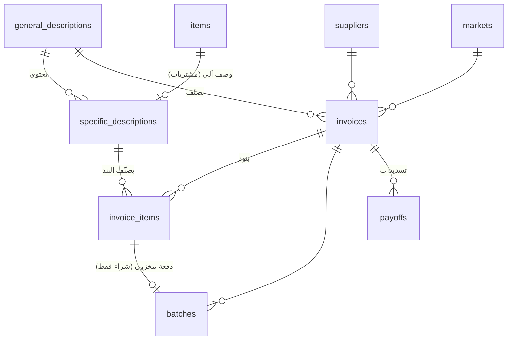
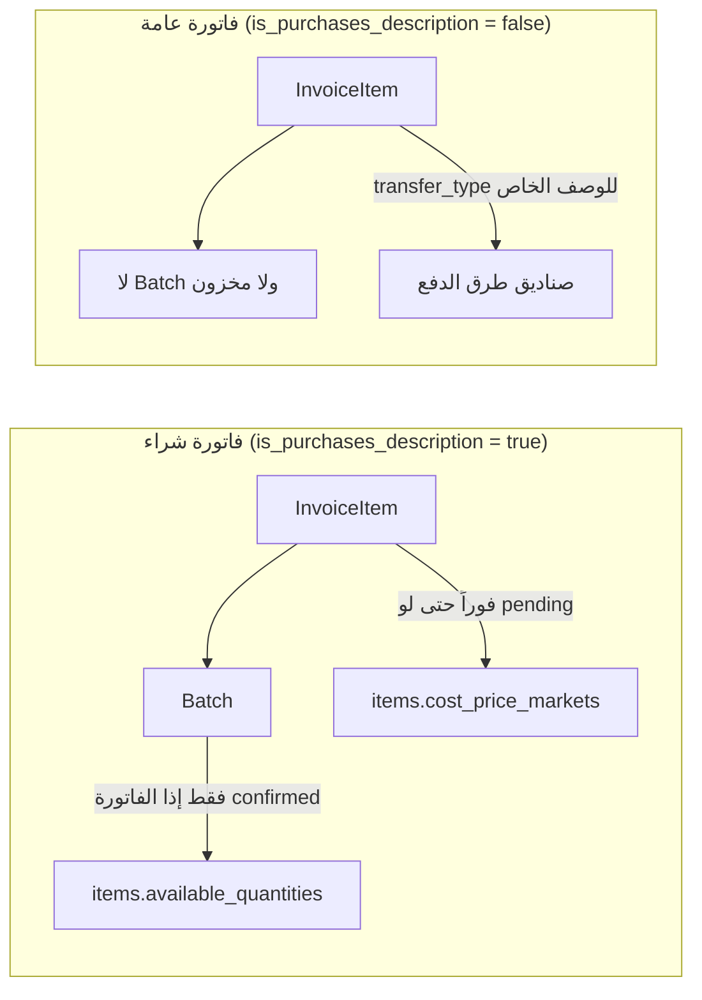
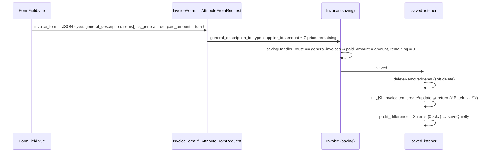
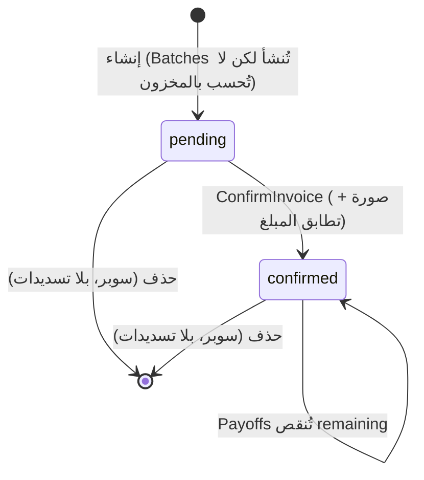
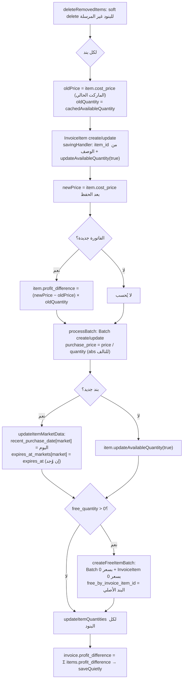

# نظام الفواتير والأوصاف — التوثيق التقني

> **النطاق:** الفواتير العامة، فواتير الشراء، الوصف العام، الوصف الخاص، وكل ما يربطها بالمخزون والصناديق والمحصلة.
> **الجمهور:** مطوّر يشتغل على الكود.
> **مصدر الحقيقة:** الكود بتاريخ 2026-09-14 (فرع `development`). الأرقام والمعرّفات المذكورة مأخوذة من قاعدة dev.

---

## الفهرس

1. [الصورة الكبيرة](#1-الصورة-الكبيرة)
2. [المصطلحات](#2-المصطلحات)
3. [نموذج البيانات](#3-نموذج-البيانات)
4. [الوصف العام](#4-الوصف-العام-general_descriptions)
5. [الوصف الخاص](#5-الوصف-الخاص-specific_descriptions)
6. [الفاتورة العامة](#6-الفاتورة-العامة-general-invoices)
7. [فاتورة الشراء](#7-فاتورة-الشراء-purchase-invoices)
8. [مكوّن InvoiceForm المشترك](#8-مكوّن-invoiceform-المشترك)
9. [الفواتير المولَّدة آلياً](#9-الفواتير-المولَّدة-آلياً)
10. [الصلاحيات](#10-الصلاحيات)
11. [الأثر على الصناديق والمحصلة](#11-الأثر-على-الصناديق-والمحصلة)
12. [الحذف والتدقيق والسجلات](#12-الحذف-والتدقيق-والسجلات)
13. [ملاحظات تقنية وفجوات معروفة](#13-ملاحظات-تقنية-وفجوات-معروفة)
14. [خريطة الملفات](#14-خريطة-الملفات)

---

## 1. الصورة الكبيرة

كل حركة مالية غير البيع تُسجَّل كفاتورة (`invoices`) لها بنود (`invoice_items`). الفاتورة تنتمي إلى **وصف عام** واحد، وكل بند ينتمي إلى **وصف خاص** واحد تحته.

- **الوصف العام** هو التصنيف الأعلى، مثل: مشتريات شركات، رواتب، تشغيلية، استثمار.
- **الوصف الخاص** هو التصنيف التفصيلي، مثل: كاشير تحت «رواتب»، أو مادة معيّنة تحت «مشتريات شركات».
- جدول واحد `invoices` يُعرض في Nova من **شاشتين**. الفاصل بينهما هو `general_descriptions.is_purchases_description`:
  - `true` ← **فواتير الشراء** (`purchase-invoices`)
  - `false` ← **الفواتير العامة** (`general-invoices`)





---

## 2. المصطلحات

| المصطلح بالواجهة | بالكود | الجدول/المورد |
|---|---|---|
| الفواتير العامة | `GeneralInvoice` | `invoices` + `app/Nova/GeneralInvoice.php` |
| فواتير الشراء | `PurchaseInvoice` | `invoices` + `app/Nova/PurchaseInvoice.php` |
| الوصوف العامة | `GeneralDescription` | `general_descriptions` |
| الوصوف الخاصة | `SpecificDescription` | `specific_descriptions` |
| البند | `InvoiceItem` | `invoice_items` |
| الدفعة | `Batch` | `batches` |
| التسديد | `Payoff` | `payoffs` |
| نوع الفاتورة: داخل / خارج | `type = input / output` | `invoices.type` |
| مؤكد / قيد الانتظار | `status = confirmed / pending` | `invoices.status` |

> يوجد أيضاً مورد ثالث `app/Nova/Invoice.php` على نفس الموديل. هو مخفي من القائمة (`availableForNavigation = false`)، ويُستعمل فقط في علاقات `HasMany`، مثل «فواتير» داخل صفحة الوصف العام.

---

## 3. نموذج البيانات

### 3.1 `general_descriptions`

| العمود | النوع | المعنى |
|---|---|---|
| `id` | bigint | معرّفات بعضها **مثبّتة بالكود** (انظر 4.2) |
| `name` | varchar | الاسم. `NetProfitValue` يبحث بالاسم («استثمار»، «ارجاع رأس مال») |
| `type` | varchar | `input` أو `output`. ينسخه الوصف الخاص تلقائياً |
| `is_purchases_description` | bool | **الفاصل الجوهري**: true = مشتريات شركات، false = مصاريف/إيرادات عامة |
| `has_suppliers` | bool | يُظهر حقل المورد بالنموذج. الـ accessor `show_suppliers = has_suppliers \|\| is_purchases_description` |
| `is_disabled` | bool | يُخفى من النموذج (`InvoiceForm` meta) ومن `relatableQuery` |
| `order` | int | ترتيب العرض. عليه global scope `order` + `SortableTrait` |
| `market_id` | bigint null | موروث وغير مستخدم: `$scoped = false`، أي الأوصاف العامة **مشتركة بين كل الماركتات** |
| `deleted_at` | ts | SoftDeletes |

### 3.2 `specific_descriptions`

| العمود | النوع | المعنى |
|---|---|---|
| `general_description_id` | bigint | الأب |
| `type` | varchar | يُنسخ من الأب في `savingHandler` |
| `item_id` | bigint null | **مملوء** = وصف مادة (مشتريات)، **فارغ** = وصف مصروف/إيراد |
| `supplier_id` | bigint null | يُستعمل لفلترة الأوصاف حسب المورد عندما `show_suppliers` بوصف غير شرائي |
| `transfer_type` | varchar null | **يربط الوصف بصندوق طريقة دفع** (انظر 5.3) |
| `is_profit_description` | bool | حقل بالواجهة («وصف ارباح عامة»)، **لا يُقرأ بأي مكان بالكود** |
| `is_disabled` | bool | عليه global scope `active` (`where is_disabled = false`) |
| `cashier_description`, `post_pay_description` | bool | **موروثة**: استُبدلت بـ `transfer_type` وحقولها معلّقة بالمورد |
| `market_id` | bigint null | موروث |

### 3.3 `invoices`

| العمود | النوع | المعنى |
|---|---|---|
| `name` | varchar | اسم حر |
| `type` | varchar | `input` / `output`. في البيانات القديمة توجد صفوف `transfer` لا يكتبها أي كود حالي |
| `general_description_id` | bigint | يحدد الشاشة (شراء/عامة) |
| `supplier_id` | bigint null | المورد (شراء أساساً) |
| `market_id` | bigint | يُملأ تلقائياً من `current_market` (الموديل الأساسي) |
| `date` | date | تاريخ الفاتورة. افتراضياً `now()` عند الإنشاء |
| `amount` | double | مجموع `price` للبنود **غير الهدايا** |
| `paid_amount` | double | المدفوع. بالشراء = مجموع `payoffs`، بالعامة = `amount` |
| `remaining` | double | الدين = `amount − paid_amount` |
| `status` | varchar | `pending` (افتراضي) / `confirmed`. **يؤثر فعلياً على فواتير الشراء فقط** |
| `checker_id` | bigint null | من أكّد الفاتورة |
| `user_id` | bigint null | منشئ الفاتورة (بالعامة يُملأ افتراضياً بـ `Auth::id()`) |
| `cashier_id` | bigint null | يعني **سحب من صندوق نقد الكاشير** (انظر 11) |
| `cash_van_driver_id` | bigint null | سائق الكاش فان في فواتير تحويل الفان |
| `original_invoice_id` | bigint null | فاتورة الإرجاع ← الفاتورة الأصلية |
| `to_market` | bigint null | فاتورة دين التحويل الداخلي ← الماركت المصدر |
| `is_defective` | bool | فاتورة تالف |
| `profit_difference` | double | فرق إعادة تقييم المخزون عند تغيّر الكلفة (مخزَّن لا يُعاد حسابه) |
| `balance_snapshot` | double | لقطة دين المورد لحظة الحفظ |
| `porterage_fee` | double | الحمالة (ماركتات تجهيز المطاعم) |
| `image` / `additional_images` | varchar / json | صور الفاتورة. `additional_images` قد يُخزَّن كنص JSON مزدوج الترميز |
| `notes` | text | ملاحظات |

### 3.4 `invoice_items`

| العمود | النوع | المعنى |
|---|---|---|
| `invoice_id`, `market_id` | bigint | |
| `specific_description_id` | bigint | الوصف الخاص |
| `general_description_id` | bigint | نسخة من وصف الفاتورة العام |
| `item_id` | bigint null | يُملأ تلقائياً من `specific_description.item_id` في `savingHandler` |
| `price` | double | **السعر الإجمالي للسطر** (ليس سعر الوحدة). كلفة الوحدة = `price / quantity` |
| `quantity` | integer* | = `boxes_count × sets_per_packet`. *الـ migration يقول `double` لكن العمود في قاعدة dev من نوع `integer` |
| `boxes_count`, `sets_per_packet` | double | عدد الكراتين وسعة الكارتون |
| `free_quantity`, `free_boxes_count`, `free_sets_per_packet` | double | الكمية المجانية |
| `free_by_invoice_item_id` | bigint null | بند مجاني ← البند الأصلي |
| `is_gift` | bool | هدية: لا تدخل في `amount` |
| `produced_at`, `expires_at` | ts | الإنتاج والصلاحية (تُنسخ للـ Batch) |
| `profit_difference` | double | فرق الربحية للسطر |
| `is_purchase` | bool | موروث وغير مستخدم |

### 3.5 جداول مرتبطة

- **`batches`**: الدفعة التي تمثّل دخول المخزون، وتربطها الأعمدة `invoice_id`, `invoice_item_id`, `item_id`, `market_id`, `quantity`, `purchase_price` (سعر الوحدة), `expires_at`, `free_by_invoice_item_id`, `market_transfer_item_id`.
- **`payoffs`**: تسديدات فاتورة الشراء، وأعمدتها `invoice_id`, `amount`, `date`, `is_cash`, `image`, `balance_snapshot`.
- **`temp_invoice_items`**: بنود مؤقتة لكل مورد، يُحمّلها النموذج بزر، وتُعرَّف بالأعمدة `temp_session_id`, `user_id`, `supplier_id`, `item_id`, … .

---

## 4. الوصف العام (`general_descriptions`)

### 4.1 الموديل والمورد

- **الموديل:** [app/Models/GeneralDescription.php](app/Models/GeneralDescription.php).
  - `$scoped = false`، فهو غير مقيَّد بالماركت.
  - مرتّب دائماً حسب `order`.
  - accessor اسمه `show_suppliers`.
- **المورد:** [app/Nova/GeneralDescription.php](app/Nova/GeneralDescription.php).
  - الحقول: الاسم، النوع، معطّل، «وصف مشتريات»، الوصوف الخاصة (HasMany)، إعادة الترتيب، الفواتير (HasMany).
  - مخفي من التنقل التلقائي؛ الرابط موجود يدوياً بالقائمة الجانبية تحت «الوصوف».
  - الإجراء المتاح: `GeneralInvoiceDownloadExcel`.

### 4.2 التصنيف الحالي (قاعدة dev)

| id | الاسم | type | مشتريات؟ | يُذكر بالكود؟ |
|---|---|---|---|---|
| **1** | استثمار | input | لا | ✅ `Investment`, `FinalMatchingResultCalculator` |
| **4** | ايرادات خارجية | input | لا | ✅ الإيرادات الخارجية بالحاسبة و`NetProfitValue` |
| **5** | مشتريات شركات | output | **نعم** | ✅ الديون، الفواتير المعلّقة، الهدايا، المصاريف (`!= 5`)، جرد |
| 7 | رواتب | output | لا | |
| 8 | ايرادات | input | لا | يحتوي أوصاف السحب من الصناديق (مثل «سحب اموال من صندوق الكاشير») |
| 10 | تشغيليه | output | لا | |
| 17 | استثمار في افرع اخرى | output | لا | |
| **18** | ارجاع رأس مال | output | لا | ✅ بالاسم في `NetProfitValue` (مستثنى من المصاريف) |
| 22 | رسوم حكومية | output | لا | |
| 23 | ايجارات | output | لا | |
| 24 | مصاريف غير متوقعة | output | لا | |
| 25 | نثرية | output | لا | |
| 26 | عمولات | output | لا | |
| 46 | تاسيس وتطوير | output | لا | |

> ⚠️ **لا تغيّر المعرّفات 1 و4 و5، ولا الاسمين «استثمار» و«ارجاع رأس مال»**. الكود يعتمد عليها حرفياً.
> يوجد وصف عام واحد فقط بـ `is_purchases_description = true`. `Item::saved` يجلبه بـ `firstOrFail()`، و`InvoiceForm` في الواجهة يختار أول وصف شرائي تلقائياً.

### 4.3 دلالة `type`

- `input`: مال يدخل صندوق المحاسب، وتحسبه الحاسبة بـ `amount`.
- `output`: مال يخرج من صندوق المحاسب، وتحسبه الحاسبة بـ `paid_amount`.

---

## 5. الوصف الخاص (`specific_descriptions`)

### 5.1 نوعان مختلفان جذرياً

| | وصف مادة | وصف مصروف/إيراد/تحويل |
|---|---|---|
| `item_id` | مملوء | `NULL` |
| الأب | الوصف الشرائي (5) | أي وصف عام غير شرائي |
| كيف يُنشأ | **آلياً** مع المادة | يدوياً من Nova |
| العدد (dev) | ~33,500 | ~100 |
| يُستعمل في | فواتير الشراء | الفواتير العامة |

### 5.2 الإنشاء الآلي لوصف المادة

داخل `Item::saved` ([app/Models/Item.php:141](app/Models/Item.php#L141)):

```php
if ($item->specific_description) {
    // مزامنة الاسم إذا تغيّر اسم المادة
} else {
    $general = GeneralDescription::where("is_purchases_description", true)->firstOrFail();
    // إنشاء SpecificDescription { name = item.name, general_description_id = $general->id, item_id = item.id }
}
```

- كل مادة لها وصف خاص واحد، والعلاقة هي `Item::specific_description()` من نوع hasOne عبر `item_id`.
- اسم الوصف يتبع اسم المادة دائماً.
- فاتورة الشراء لا تشير إلى المادة مباشرة، بل عبر هذا الوصف: `invoice_items.specific_description_id → specific_descriptions.item_id`.

### 5.3 `transfer_type`: ربط الوصف بالصناديق

الحقل يحوّل بند الفاتورة العامة إلى **سحب من صندوق طريقة دفع**. الحاسبة تجمع `invoice_items.price` لكل `transfer_type` وتطرحه من مبيعات `orders.method` المقابلة:

| `transfer_type` | التسمية | الصندوق المقابل (`orders.method`) | يدخل الحاسبة؟ | ملاحظة |
|---|---|---|---|---|
| `cash` | تحويل من الكاشيرات | `cash` | ⚠️ لا عبر transfer_type | خصم صندوق النقد يتم عبر `invoices.cashier_id` (انظر 9) |
| `post_pay` | آجل موظفين طلباتي | `post_pay` | ✅ | |
| `app_post_pay` | آجل تطبيق طلباتي | `app_post_pay` | ✅ | |
| `driver_post_pay` | آجل السائقين | `driver_post_pay` | ✅ | |
| `business_post_pay` | شركات طلباتي آجل | `business_post_pay` | ✅ | |
| `business_cash` | مطاعم نقد | `business_cash` | ✅ | **إدخاله يدوياً ممنوع** بماركتات تجهيز المطاعم |
| `cash_van` | كاش فان | `cash_van` | ✅ | **إدخاله يدوياً ممنوع بكل الماركتات** |
| `credit_card` | بطاقات | `credit_card` | ✅ | |
| `waste` | تالف/هدر | `waste` | ✅ | |
| `market_transfer` | تحويل داخلي | `MarketTransfer::completedOutflowFrom` | ✅ | |
| `rental` | إيجار | — | ❌ | |
| `NULL` | وصف عادي | — | — | مصروف/إيراد عادي |

**أثر الفاتورة الواحدة:** سحب بـ `type = input` ووصف له `transfer_type` يعني نقل مال بين صندوقين: صندوق طريقة الدفع ينقص بالمبلغ، وصندوق المحاسب يزيد بنفس المبلغ، فتبقى المحصلة بلا تغيير.

### 5.4 حارس الإدخال اليدوي

في `InvoiceItem::boot → creating` ([app/Models/InvoiceItem.php:51](app/Models/InvoiceItem.php#L51)):

1. `transfer_type = cash_van` ← `ValidationException` (422) **بكل الماركتات**.
2. `transfer_type = business_cash` ← 422 إذا `Market::blocksManualBusinessCashWithdrawal($marketId)`، أي أن الماركت ماركت تجهيز مطاعم وغير موجود بـ `MANUAL_BUSINESS_CASH_MARKETS`.

- الخدمات الآلية تكتب بـ `DB::table()`، **فلا تمرّ من هذا الحارس أصلاً**. هذا مقصود.
- الواجهة تكمّل الحارس: `SiteController::getDescriptions` يضيف `blocked_reason` و`blocked_action` لوصف `business_cash`، و`FormField.vue::fill()` يرفض الحفظ.

### 5.5 المورد

[app/Nova/SpecificDescription.php](app/Nova/SpecificDescription.php):
- الحقول: الاسم، النوع (بالفهرس فقط)، الوصف العام (مطلوب)، `transfer_type`، وصف أرباح، معطّل، المورد.
- الفلتر `ShowPurchasesDescriptions` يفصل أوصاف المواد (`item_id NOT NULL`) عن غيرها.
- `globallySearchable = false`.

---

## 6. الفاتورة العامة (`general-invoices`)

**المورد:** [app/Nova/GeneralInvoice.php](app/Nova/GeneralInvoice.php)

### 6.1 الاستعلام

```php
Invoice::whereHas('general_description', fn($q) => $q->where('is_purchases_description', false))
       ->whereMarketId($user->current_market)
       ->orderByDesc('created_at')
```

- **البحث:** بالاسم جزئياً (`ilike`)، وبالمعرّف والمبلغ **مطابقةً تامة** عبر `applySearch` المخصص.
- **الفلاتر:** `DateRangeFilter('date')` + `DescriptionsFilter`. الأخير يفلتر بالوصف العام (`general_description_id`) وبالوصف الخاص (`whereHas items`)، ويعرض الأوصاف غير الشرائية فقط.
- **الإجراءات:** `GeneralInvoiceDownloadExcel`.

### 6.2 النموذج

- الحقول: الاسم، التاريخ (مطلوب)، المستخدم، `InvoiceForm::make($request, true)` (أي `isGeneral = true`)، الصور، الملاحظات، التسديدات، التدقيق.
- **داخل InvoiceForm للفاتورة العامة:**
  - يختار المستخدم **النوع** (خارج/داخل)، فتظهر الأوصاف العامة **غير الشرائية** من ذلك النوع فقط.
  - كل بند له وصف خاص + سعر. عند الحفظ تُفرض القيم `quantity = 1` و`boxes = 1` والمجاني صفراً.
  - `paid_amount = total`.
  - تاريخ الصلاحية `nullable`.

### 6.3 مسار الحفظ



**النتيجة:** فاتورة `status = pending` (القيمة الافتراضية، ولا يؤكد الفواتير العامة أي مسار)، `paid_amount = amount`، `remaining = 0`، وبنودها بلا دفعات.

### 6.4 صلاحيات خاصة بالمورد

| الفعل | الشرط |
|---|---|
| تعديل | `parent` **و** `is_super` فقط |
| حذف | `parent` **و** (سوبر، أو خلال 24 ساعة من `created_at`) |

---

## 7. فاتورة الشراء (`purchase-invoices`)

**المورد:** [app/Nova/PurchaseInvoice.php](app/Nova/PurchaseInvoice.php)

### 7.1 الاستعلام والواجهة

- `whereHas general_description.is_purchases_description = true` + الماركت الحالي. الترتيب الافتراضي `updated_at desc`.
- **الكروت:** `PurchasesBySupplier`, `DebtBySupplier`, `StillItemsBySupplier`, `CountPurchaseInvoiceNotConfirmed`.
- **الفلاتر:** `CheckedFilter`, `CreatedAtFilter`, `SupplierFilter`, `StatusFilter`, `DefectiveFilter`, `MarketTransferInvoiceFilter`.
- **الإجراءات:** `SaveAndDuplicateInvoice`, `UpdateProfitDifference`, `DownloadExcel`, `ConfirmInvoice`.

### 7.2 الحقول

| الحقل | ملاحظة |
|---|---|
| فرق الربحية `profit_difference` | يظهر بصلاحية `profit-difference-invoice` |
| الاسم، الملاحظات | read-only لغير السوبر عند التعديل |
| تالف `is_defective` | بصلاحية `mark-is-defective-invoice` |
| التاريخ (نموذج) | بصلاحية `select-custom-invoice-date`، وإلا يأخذ `now()` |
| `InvoiceForm::make($request, false)` | لغير السوبر عند التعديل: `fillUsing(fn () => null)`، أي **البنود لا تُعالَج إطلاقاً** |
| الحمالة `porterage_fee` | تظهر فقط إذا `market.is_restaurant_supply_market`، وهناك **إلزامية** |
| الصور `additional_images` | لغير السوبر عند التعديل: **إضافة فقط** (دمج مع القديمة بلا حذف) |
| الحالة (Badge)، المدقق، الدفعات، التسديدات، التدقيق | |

### 7.3 دورة الحياة



### 7.4 مسار الحفظ خطوة بخطوة

**(1) الواجهة (`FormField.vue::fill`)**
- ترفض الحفظ إذا:
  - وُجد وصف ممنوع (`blocked_reason`).
  - أو وُجد بند **كلفة وحدته أعلى من سعر بيعه** (`invalidItems`).
- لكل بند:
  - عادي: `quantity = boxes_count × sets_per_packet` و`free_quantity = free_boxes_count × free_sets_per_packet`.
  - تالف: `boxes_count` سالب، والكمية سالبة، والمجاني والهدية تُصفَّر.
- ترسل `{general_description, type, items[], is_general:false, paid_amount, amount = total (بلا هدايا), supplier_id}`.
- تحذف مسودة `localStorage`.

**(2) التحقق (`InvoiceForm::setRules`)**
- `general_description`, `type`, `items` (≥1), `items.*.price|quantity|specific_description_id` مطلوبة، و`paid_amount lte:amount`.
- **تاريخ الصلاحية:**
  - ماركت 3 (الأعظمية): مطلوب **فقط** إذا كان رصيد المادة بالماركت ≤ 0 (`expirationRulesPerItem`).
  - باقي الماركتات: مطلوب دائماً.

**(3) تعبئة الفاتورة (`fillAttributeFromRequest`)**
```text
invoice.general_description_id = values.general_description
invoice.type                   = values.type
invoice.supplier_id            = values.supplier_id
invoice.paid_amount            = values.paid_amount        (عند الإنشاء = null/0)
invoice.amount                 = Σ item.price  (is_gift مستثنى)
invoice.remaining              = values.amount − values.paid_amount
invoice.balance_snapshot       = Σ remaining لنفس المورد بالماركت + values.amount
```
بعدها يُسجَّل listener على `Invoice::saved` لمعالجة البنود.

**(4) معالجة البنود (`handleInvoiceSaved`)**



### 7.5 كيف تتأثر الكمية والكلفة

**الكمية** ([Item::updateAvailableQuantity](app/Models/Item.php#L887)):
```text
available_quantities[market] = Σ confirmed_batches.quantity − Σ order_items.quantity
confirmed_batches = batches التي لها invoice_item، وفاتورتها status = 'confirmed'
```
← **فاتورة الشراء المعلّقة لا تضيف مخزوناً**. التأكيد هو ما يُدخل الكمية.

**الكلفة** ([Item::updateCostPrice](app/Models/Item.php)):
```text
cost_price_markets[market] = round(last_invoice_item.price / last_invoice_item.quantity, 2)
last_invoice_item = آخر invoice_item للوصف بالماركت (orderBy invoice_id desc) حيث quantity > 0 و price > 0
```
- ← **لا يفحص الحالة**: الكلفة تتحدّث فوراً حتى والفاتورة `pending`. هذا يسبب عدم تماثل مؤقتاً بين الكمية والكلفة في المحصلة.
- الكلفة القديمة تُحفظ في `last_cost_price[market]`.

### 7.6 التأكيد (`ConfirmInvoice`)

[app/Nova/Actions/ConfirmInvoice.php](app/Nova/Actions/ConfirmInvoice.php)

1. فاتورة واحدة فقط.
2. **صورة إلزامية** (`image` أو `additional_images` بعد فك ترميز JSON). يُستثنى المورد إذا كان `Supplier::allowsInvoiceWithoutImage()` صحيحاً، أي اسمه يحوي («تصحيح» و«موظف») أو «جويس».
3. المستخدم يُدخل المبلغ، ويجب أن يساوي `invoice.amount`.
4. يُرفض إذا كانت الفاتورة مؤكدة مسبقاً.
5. `status = confirmed`، `checker_id = auth()->id()`، ثم `updateAvailableQuantity(true)` لكل مادة.

الصلاحية: `confirm-invoice`.

### 7.7 التسديدات (`Payoff`)

[app/Models/Payoff.php](app/Models/Payoff.php)

- **عند الإنشاء/التعديل/الحذف/الاستعادة** تُنفَّذ `updateAmounts`:
  ```text
  invoice.paid_amount = Σ payoffs.amount
  invoice.remaining   = invoice.amount − Σ payoffs.amount
  payoff.balance_snapshot = دين المورد بالماركت − Σ payoffs
  ```
- **مواعيد الدفع:** ما لم يكن الماركت ماركت تجهيز مطاعم أو `requires_payment_appointments = false`:
  - يجب وجود `Appointment` للمورد **اليوم**، وإلا يُرمى استثناء.
  - تسديد واحد فقط لكل مورد باليوم (`is_paid`).
  - حذف التسديد يحذف موعد ذلك اليوم.

### 7.8 حالات خاصة

| الحالة | السلوك |
|---|---|
| **هدية** `is_gift` | السطر مستثنى من `amount`، لكن الـ Batch يُنشأ بسعر وحدة عادي. الحاسبة تضيف مجموع أسعار الهدايا (`giftItemsTotal`) |
| **مجاني** `free_quantity` | Batch + InvoiceItem منفصلان بسعر 0، مرتبطان بـ `free_by_invoice_item_id` |
| **تالف** `is_defective` | الواجهة تفرض المورد 430 وكميات سالبة وسعراً محسوباً من الكلفة. الـ Batch يأخذ `abs(price)/abs(qty)`. الحاسبة تستثني التالف من الديون والمعلّق وتطرح `amount` كـ `defectiveCost` |
| **الحمالة** | حقل مالي منفصل على الفاتورة (ماركتات تجهيز المطاعم) |
| **نسخ** `SaveAndDuplicateInvoice` | يخزّن البنود في Cache لمدة 30 دقيقة بمفتاح `invoice-duplicate-payload:{uuid}`، ويفتح `/purchase-invoices/new?duplicate_token=…`، والواجهة تجلبه مرة واحدة (`Cache::pull`) |
| **مسودة** | `localStorage["{market}.draftInvoice"]` لفواتير الشراء الجديدة فقط |
| **بنود مؤقتة** | زر يجلب `temp_invoice_items` للمورد المختار ويحوّلها لبنود |
| **سعر الصرف** | حقل يضرب أسعار كل البنود بالرقم المُدخل |
| **كمية شاذة** | `InvoiceItem::is_quantity_abnormal`: خارج ±2σ من آخر 20 شراء (بصفحة التفاصيل) |
| **تنبيه ارتفاع الكلفة > 20%** | endpoint `change-cost-price` موجود، لكن استدعاؤه في `fill()` **معلَّق** |
| **إرجاع** | انظر 9.6 |

### 7.9 صلاحيات خاصة بالمورد

| الفعل | الشرط |
|---|---|
| تعديل | `parent` **و** (سوبر، أو خلال 24 ساعة من `created_at`). غير السوبر يعدّل الصور فقط فعلياً |
| حذف | **سوبر فقط** و**بلا تسديدات** (لا يستدعي `parent`) |

---

## 8. مكوّن `InvoiceForm` المشترك

الحزمة: `nova-components/InvoiceForm`، واسمها `hdrm147/invoice-form`.

### 8.1 الأجزاء

| الملف | الدور |
|---|---|
| [src/InvoiceForm.php](nova-components/InvoiceForm/src/InvoiceForm.php) | Field: meta، التحقق، التعبئة، معالجة البنود والدفعات |
| [src/Http/Controllers/Controller.php](nova-components/InvoiceForm/src/Http/Controllers/Controller.php) | endpoints مساعدة |
| [resources/js/components/FormField.vue](nova-components/InvoiceForm/resources/js/components/FormField.vue) | واجهة الإنشاء/التعديل (~2170 سطر) |
| [resources/js/components/DetailField.vue](nova-components/InvoiceForm/resources/js/components/DetailField.vue) | عرض البنود + الإرجاع |

### 8.2 الـ meta المرسلة للواجهة (عند الإنشاء/التعديل فقط)

```php
"is_general"           => bool,
"suppliers"            => Supplier::all(),
"general_descriptions" => GeneralDescription::get()->where('is_disabled', false)->groupBy('type'),
"can_update_price"     => can('update-price', 'items'),
```
+ `Nova.config.canEditSavedInvoice` من `NovaServiceProvider` (gate `edit-saved-invoice`).

### 8.3 منطق الواجهة الرئيسي

- **الأوصاف العامة المعروضة** = أوصاف النوع المختار، مفلترة:
  - في `purchase-invoices`: `is_purchases_description = true`.
  - غير ذلك: `false`.
- **الشراء:** يختار تلقائياً أول وصف شرائي عند `mounted`، والنوع الافتراضي `output`.
- **تغيير النوع** يصفّر الوصف العام، و**تغيير الوصف العام** يصفّر أوصاف البنود.
- **وضع القفل `isEditMode`** = تعديل **و** ليس سوبر **و** لا يملك `edit-saved-invoice`. يقفل النوع والوصف والمورد والبنود المحفوظة.
- **فحص التكرار:** تنبيه إذا أُضيفت نفس المادة مرتين.
- **تعبئة الصلاحية تلقائياً** (ماركت 3): من `items.expires_at_markets[market]` إذا كان الرصيد > 0.

### 8.4 الـ endpoints

| الطريقة | المسار | الوظيفة |
|---|---|---|
| GET | `/nova-vendor/invoice-form/descriptions` | بحث الأوصاف الخاصة للوصف العام: رقم = باركود مطابق، نص = اسم `like`. للشراء: join مع `items` واستثناء `is_pack`. 50 نتيجة. **معرّف في `routes/web.php` ← `SiteController`** |
| POST | `/nova-vendor/invoice-form/descriptions/barcodes` | أوصاف بقائمة باركودات (`SiteController`) |
| GET | `/nova-vendor/invoice-form/descriptions/ids` | (`SiteController`) |
| POST | `/nova-vendor/invoice-form/descriptions/by-items` | أوصاف حسب `item_ids` |
| GET | `/nova-vendor/invoice-form/previous-cost-price/{specificDescription}` | آخر كلفة وحدة بالماركت أو `NOT_FOUND` |
| POST | `/nova-vendor/invoice-form/update-item-price` | تعديل سعر البيع بالماركت (`update-price-items`، يُرفض إذا كان أقل من الكلفة) |
| POST | `/nova-vendor/invoice-form/toggle-item-online` | `visible_online_markets[market]` |
| POST | `/nova-vendor/invoice-form/change-cost-price` | إشعار ارتفاع الكلفة (غير مستدعى حالياً) |
| GET | `/nova-vendor/invoice-form/duplicate-payload/{token}` | بيانات النسخ من Cache |
| GET | `/nova-vendor/invoice-form/temp-invoice-items/by-supplier/{id}` | البنود المؤقتة للمورد |
| POST | `/nova-vendor/invoice-form/{invoice}/return` | إنشاء فاتورة إرجاع |

---

## 9. الفواتير المولَّدة آلياً

كل هذه المسارات تكتب في `invoices`/`invoice_items` **خارج** نموذج Nova:

| # | المصدر | type | الوصف | status | طريقة الكتابة | علامات مميزة |
|---|---|---|---|---|---|---|
| 9.1 | أداة تحويل أموال الكاشير `MoneyTransfer` | input | وصف `transfer_type = cash` | pending | Eloquent | **`cashier_id` = الكاشير**. التحقق: رصيد الكاشير بالتاريخ ≥ المبلغ |
| 9.2 | `CashWithdrawalService::createFor` (سند قبض مطاعم) | input | `business_cash` | pending | `DB::table` | اسم `سحب تلقائي من سند قبض #id`، `paid = amount`، ويُلغى بـ soft delete مع ملاحظة عند إلغاء السند |
| 9.3 | `CashWithdrawalService::createForLegacyDebt` | input | `business_cash` | pending | `DB::table` | `سحب دين قديم - {مطعم}`، ماركت واحد من `config/receivables.php` |
| 9.4 | `CashVanCashTransferService::transfer` | input | `cash_van` | pending | `DB::table` | `cash_van_driver_id`، **⛔ ممنوع `cashier_id`**، المبلغ ≤ ما بذمّة السائق |
| 9.5 | `MarketTransferService` | output | الوصف الشرائي | **confirmed** | Eloquent | بالماركت المستلم: فاتورة دين `Debt Invoice` لمورد `{ماركت المصدر} - تحويلات داخلية` مع `to_market` + بنود + Batches. بالماركت المصدر: بند سالب بسعر 0 (`general_description_id = 0`) + Batch سالب |
| 9.6 | إرجاع (`Controller::returnItems`) | نفس الأصلية | نفس الأصلية | pending | Eloquent | `original_invoice_id`، بنود بكمية **سالبة** وسعر `unit × qty` موجب، `paid_amount = −amount`، `remaining = 0` |
| 9.7 | `CreateAuditAdjustmentInvoice` (من المواد) | output | 5 | pending | Eloquent | `تعديل جرد - {تاريخ}`، المورد افتراضياً 414، الكمية = فرق الجرد، السعر = الفرق × الكلفة، Batches، وتصفير حقول الجرد |

> **لماذا `DB::table` في 9.2 إلى 9.4؟** لتفادي أحداث الموديل الثقيلة، **ولتجاوز حارس `InvoiceItem::creating`** الذي يمنع الإدخال اليدوي لنفس الأوصاف.

---

## 10. الصلاحيات

الصلاحيات صفوف في `permissions` بالشكل (`user_id`, `market_id`, `ability`)، تُحلّ عبر `current_market`، و`is_super` يتجاوز الكل.

### 10.1 السياسات

| السياسة | viewAny/view | create | update | delete | restore | forceDelete |
|---|---|---|---|---|---|---|
| `InvoicePolicy` | `view-invoice` (+ نفس الماركت) | `create-invoice` | `update-invoice` + نفس الماركت + `is_editable` | `drop-invoice` | `restore-invoice` | `force-drop-invoice` |
| `GeneralDescriptionPolicy` | `view-general-description` | `create-…` | `update-…` | `drop-…` | `restore-…` | `force-drop-…` |
| `SpecificDescriptionPolicy` | `view-specific-description` أو `consume-storage-item` أو `spoil-kitchen-ingredient` | `create-…` | `update-…` | `drop-…` | `restore-…` | `force-drop-…` |
| `PayOffPolicy` | `view-payoff` | `create-payoff` | `update-payoff` + نفس الماركت | `drop-payoff` | `restore-payoff` | سوبر فقط |

> الشاشتان (العامة والشراء) تستعملان نفس `InvoicePolicy` لأن الموديل واحد. الفروق بينهما تأتي من `authorizedToUpdate`/`authorizedToDelete` بكل مورد (6.4 و7.9).

### 10.2 البوابات الخاصة

| Ability | الأثر |
|---|---|
| `confirm-invoice` | إجراء التأكيد |
| `profit-difference-invoice` | رؤية عمود فرق الربحية |
| `mark-is-defective-invoice` | حقل «تالف» |
| `select-custom-invoice-date` | اختيار تاريخ فاتورة الشراء |
| `edit-saved-invoice` | فك قفل البنود المحفوظة **بالواجهة** (راجع 13) |
| `update-price-items` | تعديل سعر البيع من داخل النموذج |
| `view-all-incomplete-invoices` | لوحة الفواتير غير المكتملة لكل الماركتات |
| `view-invoice-finder` | أداة البحث عن الفواتير |

### 10.3 القائمة الجانبية

[resources/views/vendor/nova/resources/navigation.blade.php](resources/views/vendor/nova/resources/navigation.blade.php):
- **«الفواتير العامة»** تضم: `general-invoices` و`purchase-invoices`، وتظهر بـ `canViewAny('invoice')`.
- **«الوصوف»** تضم: `general-descriptions` و`specific-descriptions`.

---

## 11. الأثر على الصناديق والمحصلة

المرجع: [app/Services/FinalMatchingResultCalculator.php](app/Services/FinalMatchingResultCalculator.php) و[FINANCIAL_MATCHING.md](FINANCIAL_MATCHING.md). كل الاستعلامات تستثني المحذوف ناعماً تلقائياً.

### 11.1 قيمة الماركت (Market Value)

| المكوّن | الصيغة من الفواتير |
|---|---|
| صندوق المحاسب | `Σ amount (type=input)` − `Σ paid_amount (type=output)` |
| صندوق النقد (خارج) | `Σ amount` لكل فاتورة فيها **`cashier_id`** (مهما كان نوعها) |
| صناديق طرق الدفع (خارج) | `Σ invoice_items.price` حسب `specific_description.transfer_type` |
| التحويل الداخلي (خارج) | `Σ price` لـ `transfer_type = market_transfer` |
| الديون | `Σ remaining` حيث `general_description_id = 5` وغير تالف |
| المخزن | `Σ cost_price_markets × available_quantities` (يتأثر بالـ Batches المؤكدة) |

### 11.2 النتيجة المحاسبية (Accounting Result)

```text
result = giftItemsTotal                         Σ price للهدايا بفواتير 5 الخارجة
       + investment                             Σ paid_amount (gd = 1)
       + Σ order_items.profit
       + Σ invoices.profit_difference           ← من فواتير الشراء
       − expenses                               Σ paid_amount (output, gd ≠ 5)
       + lost_value (ثابت لكل ماركت)
       + externalRevenues                       Σ paid_amount (input, gd = 4)
       − defectiveCost                          Σ amount (is_defective)
       − sumInvoicePending                      Σ amount (gd = 5, output, pending, غير تالف)

FinalMatchingResult = result − marketValue       (يجب أن يبقى قريباً من الصفر)
```

### 11.3 ماذا يعني هذا عملياً

- **فاتورة شراء pending:** كميتها لم تدخل المخزن، ودينها داخل `remaining`، ومبلغها مطروح من `result`. التأكيد يُدخل الكمية ويزيل الطرح.
- **فاتورة عامة `output` بلا `transfer_type`:** مصروف. تُنقص صندوق المحاسب وتُنقص `result` بنفس القيمة، فالمحصلة متوازنة.
- **فاتورة عامة `input` بوصف له `transfer_type`:** نقل بين صندوقين، والمحصلة بلا تغيير.
- **`cashier_id` على أي فاتورة** يطرح مبلغها من صندوق النقد. وضعه خطأً يحرف المحصلة، وهذا سبب منعه في 9.4.
- **`profit_difference`** يعوّض إعادة تقييم المخزون الموجود عند تغيّر الكلفة. هو مخزَّن ولا يُعاد حسابه عند تعديل الفاتورة أو حذف غيرها، فيسبب انحرافاً صغيراً معروفاً.

### 11.4 الميتركس المعتمدة على الأوصاف

| الميتريك | الشرط |
|---|---|
| `Expenses` | `general_description_id != 5` |
| `NetProfitValue` | الإيرادات: gd = 4. المصاريف: output و gd ≠ 5، باستثناء «ارجاع رأس مال» **بالاسم** |
| `Investment` | gd = 1 |
| `SumInvoicePending`, `IncompleteInvoicesCount`, لوحة `IncompleteInvoicesDashboardTool` | gd = 5 و `status = pending` |
| `GiftItemsValue` | `is_gift` بفواتير output gd = 5 |

---

## 12. الحذف والتدقيق والسجلات

### 12.1 الحذف

كل الموديلات ترث `App\Models\Model`، الذي يضيف `SoftDeletes` + `Auditable` + تعبئة `market_id` تلقائياً.

```mermaid
flowchart LR
    I[Invoice deleted] --> B[batches->each->delete]
    I --> II[invoice_items->each->delete]
    II --> B2[InvoiceItem softDeleted: batch()->delete]
    B2 --> Q["item->updateAvailableQuantity(true) ⇒ الكمية + الكلفة"]
    I --> L["afterResponse: FinalMatchingResultLogger + MarketValueGapLogger"]
```

- `forceDeleted` يُنفّذ نفس المسار لكن بحذف نهائي.
- عند الحذف النهائي للـ Batch، `BatchObserver` يفرّغ `order_items.batch_id`.
- **التسديدات لا تُحذف مع الفاتورة.** فاتورة الشراء لا تُحذف أصلاً إذا كان لها تسديدات.

### 12.2 السجلات

- `Invoice::created/updated/deleted/forceDeleted` ← `logBoth` بعد الاستجابة. تحسب المحصلة وقيمة الماركت، وتسجّلهما في `FinalMatchingResultLogger` و`MarketValueGapLogger`.
- `Item::updateAvailableQuantity` و`updateCostPrice` يكتبان `Log::info` بكل تغيير (الفرق، الكمية، `triggered_by`).
- التدقيق (`owen-it/laravel-auditing`) يظهر كـ HasMany `Audits` بصفحة الفاتورة.

---

## 13. ملاحظات تقنية وفجوات معروفة

ملاحظات موثّقة من قراءة الكود، **وليست تغييرات مطبّقة**:

1. **`InvoiceObserver` غير مسجّل** في `AppServiceProvider`، فكوده ميت. منطق الحذف الفعلي في `Invoice::boot`.
2. **`Invoice::getIsEditableAttribute` يرجع `true` دائماً.** الشرط بعده (`date->isFuture() || status != confirmed`) لا يُنفَّذ، فشرط `is_editable` في `InvoicePolicy::update` بلا أثر.
3. **تعارض بين `edit-saved-invoice` والخادم:** الواجهة تفك قفل البنود لمن يملك الصلاحية. لكن `PurchaseInvoice` يضع `fillUsing(fn () => null)` لكل غير سوبر عند التعديل، **فتعديلات البنود تُتجاهل بصمت**.
4. **الكلفة تتحدّث قبل التأكيد والكمية بعده.** `getPreviousCostPriceAtMarket` لا يفلتر `status`، فيحدث انحراف مؤقت بالمحصلة بين الإدخال والتأكيد.
5. **`profit_difference` يُحسب فقط عند إنشاء الفاتورة** (`wasRecentlyCreated`). تعديل البنود أو إضافة بند لاحقاً لا يحسب له فرقاً.
   - إجراء `UpdateProfitDifference` يستعمل **صيغة مختلفة**: فرق سعر آخر شراء × (مجموع المشتريات − المبيعات قبل تاريخ الفاتورة، بلا فلترة حالة).
6. **فاتورة الإرجاع (`returnItems`) لا تنشئ `Batch`.** بما أن الكمية تُحسب من الـ Batches المؤكدة، هذا المسار وحده لا يُنقص المخزون.
   - أيضاً: سعر البند موجب مع كمية سالبة، والحالة `pending` افتراضياً.
7. **listener الحفظ ثابت على الكلاس:** `$invoice::saved(...)` يُسجَّل على `Invoice` كلها طوال عمر العملية، لا على النسخة وحدها. `saveQuietly` في نهايته يمنع التكرار داخل نفس الطلب.
8. **`remaining` يُحسب من `values.amount` القادم من الواجهة**، بينما `amount` يُعاد حسابه بالخادم. هما متطابقان حالياً لأن الطرفين يستثنيان الهدايا.
9. **`invoice_items.quantity` من نوع `integer`** في قاعدة dev رغم أن الـ migration تقول `double`. الكميات العشرية في البند تُقرَّب، بينما `batches.quantity` من نوع `double`.
10. **قاعدة «لا تأريخ لشهر سابق»** موجودة فقط على المورد المخفي `App\Nova\Invoice`، لا على شاشتي العامة والشراء.
11. **`is_profit_description`** بلا أي استخدام في الكود.
12. **تعليق `CashWithdrawalService`** يشير إلى `App\Observers\InvoiceItemGuard` غير الموجود. الحارس الفعلي في `InvoiceItem::boot`.
13. **معرّفات مثبّتة:** 1 و4 و5 بالرقم، و«استثمار» و«ارجاع رأس مال» بالاسم، والمورد 430 (تالف) و414 (جرد)، والماركت 3 (قاعدة الصلاحية)، وماركت 12 (دقة الكمية).
14. **صفوف `type = transfer`** موجودة بالبيانات بلا كود حالي يكتبها. الحاسبة تتجاهلها لأنها تفلتر `input`/`output` فقط.

---

## 14. خريطة الملفات

| الطبقة | الملفات |
|---|---|
| موديلات | [Invoice](app/Models/Invoice.php) · [InvoiceItem](app/Models/InvoiceItem.php) · [GeneralDescription](app/Models/GeneralDescription.php) · [SpecificDescription](app/Models/SpecificDescription.php) · [Payoff](app/Models/Payoff.php) · [Batch](app/Models/Batch.php) · [TempInvoiceItem](app/Models/TempInvoiceItem.php) · [Model (الأساس)](app/Models/Model.php) · [Item](app/Models/Item.php) |
| موارد Nova | [GeneralInvoice](app/Nova/GeneralInvoice.php) · [PurchaseInvoice](app/Nova/PurchaseInvoice.php) · [Invoice (مخفي)](app/Nova/Invoice.php) · [GeneralDescription](app/Nova/GeneralDescription.php) · [SpecificDescription](app/Nova/SpecificDescription.php) |
| إجراءات | [ConfirmInvoice](app/Nova/Actions/ConfirmInvoice.php) · [SaveAndDuplicateInvoice](app/Nova/Actions/SaveAndDuplicateInvoice.php) · [UpdateProfitDifference](app/Nova/Actions/UpdateProfitDifference.php) · [CreateAuditAdjustmentInvoice](app/Nova/Actions/CreateAuditAdjustmentInvoice.php) · [GeneralInvoiceDownloadExcel](app/Nova/Actions/GeneralInvoiceDownloadExcel.php) |
| النموذج | [InvoiceForm.php](nova-components/InvoiceForm/src/InvoiceForm.php) · [Controller](nova-components/InvoiceForm/src/Http/Controllers/Controller.php) · [routes](nova-components/InvoiceForm/routes/api.php) · [FormField.vue](nova-components/InvoiceForm/resources/js/components/FormField.vue) · [DetailField.vue](nova-components/InvoiceForm/resources/js/components/DetailField.vue) · [SiteController::getDescriptions](app/Http/Controllers/SiteController.php) |
| خدمات | [CashWithdrawalService](app/Services/CashWithdrawalService.php) · [CashVanCashTransferService](app/Services/CashVanCashTransferService.php) · [MarketTransferService](app/Services/MarketTransferService.php) · [MoneyTransfer Controller](nova-components/MoneyTransfer/src/Http/Controllers/Controller.php) · [FinalMatchingResultCalculator](app/Services/FinalMatchingResultCalculator.php) |
| صلاحيات | [InvoicePolicy](app/Policies/InvoicePolicy.php) · [GeneralDescriptionPolicy](app/Policies/GeneralDescriptionPolicy.php) · [SpecificDescriptionPolicy](app/Policies/SpecificDescriptionPolicy.php) · [PayoffPolicy](app/Policies/PayoffPolicy.php) · [AuthServiceProvider](app/Providers/AuthServiceProvider.php) |
| فلاتر وأدوات | [DescriptionsFilter](nova-components/DescriptionsFilter/src/DescriptionsFilter.php) · [DescriptionsTree](nova-components/DescriptionsTree/src/Http/Controllers/Controller.php) · [ShowPurchasesDescriptions](app/Nova/Filters/ShowPurchasesDescriptions.php) · [IncompleteInvoicesController](nova-components/IncompleteInvoicesDashboardTool/src/Http/Controllers/IncompleteInvoicesController.php) |
| Migrations | `database/migrations/*invoice*`, `*descript*` (2021-08-17 → 2026-09-12) |
